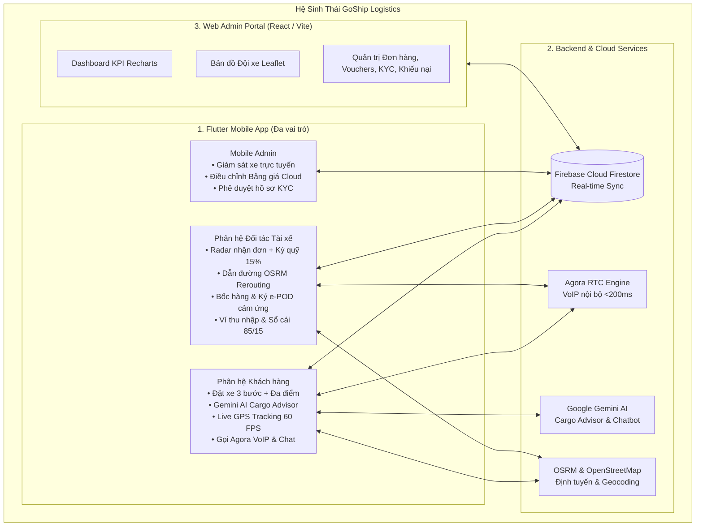

# 🚚 GoShip Logistics Ecosystem
> **Nền tảng Quản trị & Điều phối Vận tải Giao nhận Chặng cuối Toàn diện (Last-Mile Logistics)**  
> *Tích hợp Trí tuệ Nhân tạo Google Gemini AI, Viễn thông Thoại Agora RTC VoIP, Định tuyến OSRM và Đồng bộ Thời gian thực trên Cloud Firestore.*

[](https://flutter.dev)
[](https://react.dev)
[](https://vitejs.dev)
[](https://firebase.google.com)
[](https://ai.google.dev)
[](https://www.agora.io)
[](https://www.openstreetmap.org)

---

## 🌟 1. Tổng Quan Hệ Sinh Thái (Ecosystem Architecture)

GoShip Logistics là giải pháp công nghệ toàn diện phục vụ chuỗi cung ứng và giao nhận đô thị chặng cuối, bao gồm **3 phân hệ tương tác thời gian thực**:



---

## 🚀 2. Các Tính Năng Đột Phá (Key Features)

### 2.1. Phân Hệ Khách Hàng (Customer App)
* **Quy trình Đặt đơn 3 bước chuyên nghiệp (Booking Funnel):**
  * **Bước 1 (Lộ trình):** Hỗ trợ đặt đơn **đa điểm giao (Multi-stop từ 2 đến 4 điểm)**. Công cụ kéo ghim bản đồ toàn màn hình (`FullscreenMapPicker`) tự động dịch ngược tọa độ sang địa chỉ tiếng Việt qua Nominatim.
  * **Bước 2 (Kiện hàng & AI):** Lựa chọn 4 dòng xe (Xe Bán tải, Xe Van, Xe Tải, Container). Tích hợp **Google Gemini AI Cargo Advisor** tự động phân tích thể tích $m^3$ và trọng lượng để gợi ý đúng dòng xe, chống quá tải và tối ưu chi phí.
  * **Bước 3 (Thanh toán & Khuyến mãi):** Tính cước theo bảng giá động Cloud (`PricingConfigService`). Tích hợp hệ thống Voucher Firestore (`WELCOME30`, `GOSHIP50`, `TRUCK50`...). Hỗ trợ cổng thanh toán COD, QR MoMo, QR ZaloPay và bảo vệ chống nhấp đúp (`_isSubmitting`).
* **Theo dõi & Tương tác trong chuyến:**
  * Giám sát vị trí tài xế thời gian thực với thuật toán nội suy mượt mà **60 FPS**.
  * **Gọi thoại Agora RTC VoIP** chất lượng cao 2 chiều trực tiếp trong app (không tốn cước SIM) và Chat thời gian thực.
  * Hủy đơn hàng kèm lý do rõ ràng trước khi tài xế bốc hàng.
  * Xem lại ảnh chứng từ **e-POD** và Banner nhắc nhở đánh giá 5 sao tài xế ngay sau khi cuốc xe hoàn tất.

### 2.2. Phân Hệ Đối Tác Tài Xế (Driver App)
* **Radar Quét cuốc xe & Kiểm soát Ký quỹ (Escrow 15%):**
  * Công tắc Bật/Tắt Online; quét đơn mới theo bán kính thời gian thực (≤5km, ≤10km, ≤20km hoặc Tất cả).
  * **Cơ chế Ký quỹ bảo đảm:** Chặn nhận đơn nếu số dư ký quỹ không đủ 15% hoa hồng cước gốc của chuyến xe.
* **Dẫn đường Turn-by-Turn kiểu Google Maps (OSRM):**
  * Màn hình HUD hiển thị ngã rẽ tiếp theo, tên đường, khoảng cách còn lại và vận tốc di chuyển.
  * **Thuật toán Tự động tìm lại đường (Rerouting):** Tự động phát hiện khi tài xế đi lệch tuyến ban đầu >50m và tính toán lại lộ trình mới tối ưu.
* **Quy trình Giao nhận Đa điểm & Bằng chứng điện tử (e-POD):**
  * Chụp ảnh xác nhận bốc hàng tại điểm lấy.
  * Ký nhận điện tử trực tiếp trên màn hình cảm ứng (**Touchscreen Signature**) kèm chụp ảnh bàn giao hàng hóa thành công tại điểm đến có gắn Watermark GPS.
* **Ví Thu Nhập & Ký Quỹ Độc Lập (Cơ chế chia tiền 85/15):**
  * Ngay khi đơn hoàn tất: Cộng **85% cước gốc** vào Ví thu nhập và trừ **15% hoa hồng** vào Ví ký quỹ.
  * Sổ cái giao dịch minh bạch, hỗ trợ nạp/rút tiền linh hoạt về tài khoản ngân hàng.

### 2.3. Cổng Quản Trị & Điều Phối (Web Admin Portal & Mobile Admin)
* **Web Admin Portal (React 18 + Vite + Tailwind CSS):**
  * Kết nối trực tiếp 2 chiều với Cloud Firestore thông qua REST API (`firestoreCloud.ts`).
  * **Dashboard KPI:** Thống kê doanh thu, tỷ lệ hoàn tất đơn hàng bằng biểu đồ Recharts.
  * **Live Fleet Map:** Bản đồ Leaflet giám sát vị trí toàn bộ phương tiện đang Online với kỹ thuật gom cụm (Marker Clustering).
  * **Quản trị Toàn diện:** Quản lý vòng đời đơn hàng, duyệt hồ sơ định danh KYC tài xế (CCCD 2 mặt, GPLX, biển số), quản lý mã giảm giá Voucher và xử lý khiếu nại (Incidents).
* **Mobile Admin (`AdminDashboardScreen`):**
  * Điều chỉnh Bảng giá động thời gian thực (`PricingConfigService`) cho 4 dòng xe, áp dụng tức thời xuống toàn bộ ứng dụng mà không cần cập nhật bản build.
  * Hỗ trợ công tắc **Chuyển nhanh vai trò (Role Switcher)** để kiểm thử đa phân hệ trên cùng 1 máy.

---

## 🛠️ 3. Cấu Trúc Mã Nguồn (Project Structure)

```text
logitech/
├── android/                    # Cấu hình Android Native, ProGuard & Google Services
├── assets/                     # Tài nguyên biểu tượng, âm thanh cuộc gọi Agora
│   ├── images/                 # Logo, App Icons
│   └── sounds/                 # Nhạc chuông cuộc gọi, âm thanh thông báo
├── lib/                        # Mã nguồn ứng dụng Flutter chính
│   ├── core/                   # Các dịch vụ dùng chung (Core Services)
│   │   ├── constants/          # App Colors, Pricing Config, Agora Config
│   │   ├── models/             # User Model, Simulated Driver Model
│   │   ├── network/            # OSRM Route Service, Geocoding Service, API Client
│   │   ├── services/           # Firestore Order Service, Agora Voice, Gemini AI, Wallet
│   │   └── widgets/            # Map Picker, Agora Call Screen, In-trip Chat
│   ├── features/
│   │   ├── admin/              # Mobile Admin Dashboard & Pricing Editor
│   │   ├── auth/               # Unified Login, Register KYC, Splash Screen
│   │   ├── customer/           # Đặt xe 3 bước, Live Tracking, Lịch sử, Sổ địa chỉ
│   │   └── driver/             # Radar nhận đơn, Dẫn đường HUD OSRM, e-POD, Ví thu nhập
│   └── main.dart               # Điểm khởi chạy ứng dụng Flutter
├── Logistics Management System/ # Cổng Quản trị Web Admin Portal (React + Vite)
│   ├── src/
│   │   ├── app/                # Components (Orders, Drivers KYC, Vouchers, Incidents)
│   │   └── services/           # Firestore Cloud REST Integration
│   ├── package.json
│   └── vite.config.ts
├── firestore.rules             # Quy tắc bảo mật Cloud Firestore
├── firebase.json               # Cấu hình Firebase Hosting & Firestore
├── SRS_GoShip_Logistics.md     # Toàn văn Đặc tả Yêu cầu Phần mềm (SRS v2.0)
└── pubspec.yaml                # Khai báo thư viện & tài nguyên Flutter
```

---

## ⚡ 4. Hướng Dẫn Cài Đặt & Chạy Ứng Dụng

### Yêu cầu tiên quyết:
- **Flutter SDK:** Version >= 3.x
- **Node.js:** Version >= 18.x
- **Java / JDK:** Version 11 hoặc 17

### 4.0. Cấu hình Môi trường & Bảo mật Khóa API (Security Setup)
Để đảm bảo an toàn bảo mật và tránh lộ khóa riêng tư trên môi trường công khai:
```bash
# 1. Thiết lập cấu hình Firebase (nếu clone dự án lần đầu)
cp lib/firebase_options.dart.example lib/firebase_options.dart
cp android/app/google-services.json.example android/app/google-services.json

# 2. Khởi tạo file biến môi trường từ mẫu
cp .env.example .env
```
> [!NOTE]
> Bạn có thể truyền khóa API trực tiếp khi chạy/build:
> `flutter run --dart-define=GEMINI_API_KEY=your_key --dart-define=AGORA_APP_CERTIFICATE=your_cert`
> Hoặc lưu cấu hình `gemini_api_key` trực tiếp trên document `system_config/ai` của Cloud Firestore.

### 4.1. Khởi chạy Ứng dụng Di động Flutter
```bash
# 1. Cài đặt các gói phụ thuộc
flutter pub get

# 2. Kiểm tra chất lượng mã nguồn
flutter analyze

# 3. Chạy ứng dụng trên thiết bị / máy ảo
flutter run
```

### 4.2. Biên dịch Bản Phát Hành APK Tối Ưu (Chỉ ~101 MB)
```bash
# Biên dịch riêng cho kiến trúc 64-bit arm64-v8a (tiết kiệm hơn 60% dung lượng)
flutter build apk --split-per-abi --target-platform android-arm64
```

### 4.3. Khởi chạy Web Admin Portal
```bash
# 1. Chuyển vào thư mục Web Admin
cd "Logistics Management System"

# 2. Cài đặt các gói phụ thuộc npm
npm install

# 3. Khởi chạy máy chủ phát triển cục bộ
npm run dev

# 4. Biên dịch bản sản xuất (Production Build)
npm run build
```

---

## 🔑 5. Tài Khoản Kiểm Thử (Test Credentials)

| Vai trò | Tên đăng nhập / Email | Mật khẩu | Mục đích kiểm thử |
| :--- | :--- | :---: | :--- |
| **Quản trị viên (Admin)** | `admin@goship.vn` (hoặc `admin`) | `admin123` | Quản trị toàn hệ thống, duyệt KYC, chỉnh giá cước |
| **Khách hàng (Customer)** | `nguyenhuunhut1309@gmail.com` | `123456` | Đặt đơn đa điểm, AI tư vấn xe, theo dõi live GPS |
| **Khách hàng 2 (Customer)**| `vanncuong1614@gmail.com` | `123456` | Kiểm thử đơn hàng phụ và khuyến mãi |
| **Đối tác Tài xế (Driver)**| `Driver01` (hoặc `0917795211`) | `123456` | Quét radar, dẫn đường OSRM, ký e-POD, ví 85/15 |

---

## 📄 6. Giấy Phép & Bản Quyền
Dự án được xây dựng và phát triển phục vụ mục đích nghiên cứu, học tập và triển khai đồ án tốt nghiệp công nghệ phần mềm chuyên ngành Logistics & Công nghệ Thông tin. Mọi quyền được bảo lưu © 2026 GoShip Logistics.
